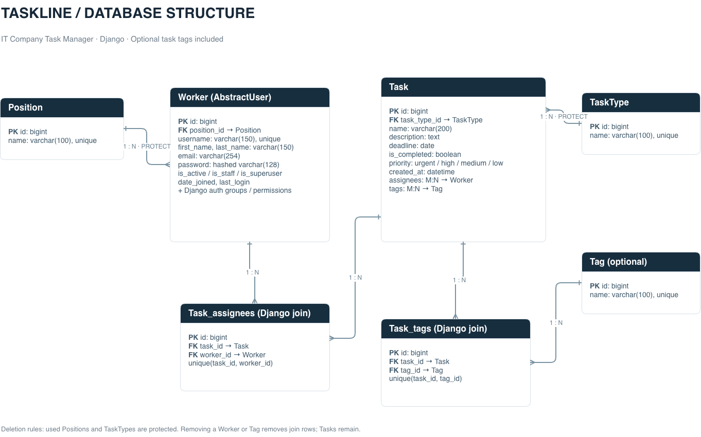

# Taskline — IT Company Task Manager

A Django portfolio project for an IT team's day-to-day work: clear priorities,
shared ownership, and a useful view of what's next.

[Live demo](https://taskline-it-company.onrender.com/) ·
[Portfolio pull request](https://github.com/sydneyhart/it-company-task-manager/pull/1)

Visitor login: **user** / **user12345**.

## Features

- Overview dashboard with active, completed, overdue, and team counts.
- Task creation, editing, deletion, deadlines, four priorities, and task types.
- Multiple assignees per task, plus **Assign to me / Leave task** actions.
- Explicit **Mark as completed / Reopen task** actions.
- Search by task name or description; combine status, priority, type, tag, and
  “assigned to me” filters. Pagination retains the filters.
- Worker creation with Django's UserCreationForm, profile editing, deletion,
  and a searchable people directory.
- Searchable CRUD catalogs for positions, task types, and tags.
- Optional features: many-to-many task tags and separate active/completed task
  sections on every worker profile.
- Bootstrap 5, Crispy Forms, a custom responsive layout, and mobile navigation.
- Django admin registrations, demo data, and GitHub Actions checks.

All workspace pages require authentication. Like the course Taxi Service example,
authenticated teammates can manage shared records. This is a collaborative
workspace, not a multi-tenant application with role-based record permissions.
Profile forms cannot change staff/superuser flags or raw passwords.

## Run locally

Requires Python 3.12+.

    git clone https://github.com/sydneyhart/it-company-task-manager.git
    cd it-company-task-manager
    git checkout develop
    python -m venv .venv
    source .venv/bin/activate
    pip install -r requirements-dev.txt
    python manage.py migrate
    python manage.py seed_demo
    python manage.py runserver

Open [Taskline locally](http://127.0.0.1:8000/).

Local demo credentials:

- Username: demo.user
- Password: Taskline-demo-2026!

The seed_demo command creates six workers and twelve tasks with relative deadlines.
Running it again does not duplicate records, reset existing passwords, or overwrite
edits. Use the --password option to choose the password when creating the demo
account for the first time. Other demo workers have unusable passwords; add real
teammates through People or Django admin.

The demo account is not a superuser. To use /admin/, first create positions with
seed_demo or the app, then run:

    python manage.py createsuperuser

Enter an existing position's primary key when prompted.

For the public portfolio demo, the Render build seeds a separate visitor account:
username `user`, password `user12345`. This account has no admin privileges and
cannot be deleted while public demo mode is enabled. All shared records are demo
data and visitors can edit them; do not enter private information.

## Checks

    flake8
    python manage.py check
    python manage.py makemigrations --check --dry-run
    python manage.py test

The 32 tests cover rendered pages, authentication, task and worker workflows,
password hashing, protection against privilege escalation in profile forms,
CSRF-protected POST actions, filter combinations, pagination encoding,
protected deletion, escaping, and repeatable demo seeding.

GitHub Actions runs the same checks on Python 3.12 for pushes and pull requests.

## Data model

The editable source is [docs/schema.drawio](docs/schema.drawio). Open it in
[draw.io](https://app.diagrams.net/) to edit it. The PNG was exported from draw.io
and includes the optional Tag model and Django's two many-to-many join tables.

- Worker extends AbstractUser and belongs to a Position.
- Task belongs to a TaskType and has many workers and tags.
- In-use positions and task types are protected from deletion.
- Removing a worker or tag only removes its task connections; tasks remain.
- Deleting a task removes its assignment/tag links, leaving workers and tags intact.

## Configuration and deployment

Local development uses SQLite. Render uses managed PostgreSQL, Gunicorn, and
WhiteNoise for compressed static files. Secrets and database files are excluded
from Git. The application refuses to start on Render without DATABASE_URL, or
with debug disabled without DJANGO_SECRET_KEY.

The root `render.yaml` deploys the `develop` branch with free web and PostgreSQL
plans in Oregon. Create a Blueprint from this repository in Render, select
`develop`, and review the resource plan before deploying. The existing
`taskline-db` database is matched by name. The Blueprint supplies DATABASE_URL
through a database reference and generates the signing secret inside Render.
No database password is stored in this repository.

The executable build.sh installs dependencies, collects static files, applies
migrations, and idempotently creates the visitor data when public demo mode is
set. `/healthz/` checks database connectivity without requiring a login.

| Environment variable | Purpose | Default |
| --- | --- | --- |
| DATABASE_URL | PostgreSQL connection URL | SQLite locally; required on Render |
| DJANGO_SECRET_KEY | Secret signing key | Development fallback; required in production |
| DJANGO_DEBUG | 1 for development, 0 for production | 0 on Render, otherwise 1 |
| DJANGO_ALLOWED_HOSTS | Comma-separated additional hosts | Local hosts plus Render hostname |
| DJANGO_CSRF_TRUSTED_ORIGINS | Comma-separated additional HTTPS origins | Render origin |
| DJANGO_TIME_ZONE | Workspace IANA timezone | UTC |
| TASKLINE_PUBLIC_DEMO | Seed visitor data and protect its account from deletion | 0 |
| TASKLINE_DEMO_USERNAME | Visitor username | user |
| TASKLINE_DEMO_PASSWORD | Initial visitor password | user12345 |

HTTPS redirects, secure cookies, proxy SSL handling, and HSTS are enabled with
debug disabled. Use a unique secret and configure real hosts for other hosts.
Run `python manage.py check --deploy` with the production environment configured.

Free Render web services sleep after inactivity, so the first visit may take
about a minute. The free PostgreSQL database expires after 30 days (the current
instance expires November 17, 2026). Upgrade or migrate before expiry to keep the
demo available; the Blueprint does not authorize any paid upgrade.

Bootstrap loads from jsDelivr, and the DM Sans/Manrope fonts load from Google
Fonts. The interface falls back to system fonts if those resources are unavailable.
Django's console email backend is used for local development.

## Portfolio review

Implementation is on develop, with separate commits for models, workflows,
each new page, tests, and documentation. The review PR targets main.
Screenshots of every custom page, mobile layouts, and the database diagram are
attached in the PR's comment area.
